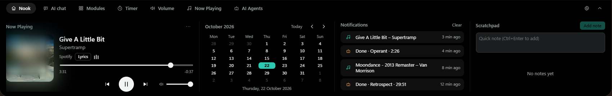
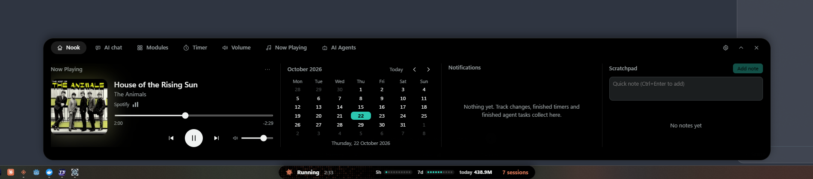
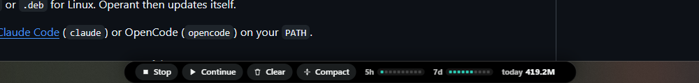

<p align="center">
  
</p>

<h1 align="center">Notifi</h1>

<p align="center">
  <strong>A small control centre for your Windows desktop.</strong><br>
  One pill, at the top of the screen or on the taskbar, opens into music, timers, AI agents, an AI chat and a set of desktop tools.<br>
  Install only the features you want. Your data stays on your PC.
</p>

<p align="center">
  <a href="LICENSE"></a>
  <a href="https://github.com/doolecg/Notifi/releases/latest"></a>
  
  
</p>

<p align="center">
  <a href="#quick-start">Quick start</a> ·
  <a href="#why-notifi">Why Notifi</a> ·
  <a href="#features">Features</a> ·
  <a href="#security-and-privacy">Security and privacy</a> ·
  <a href="#faq">FAQ</a> ·
  <a href="#contributing">Contribute</a> ·
  <a href="RELEASE_NOTES.md">Release notes</a>
</p>

---

Windows has a lot of small jobs that each want their own app: a clipboard history, a screenshot tool, a volume mixer, a timer, a window snapper, a place to see what your coding agents are doing. Each one adds a tray icon, a window and a background process.

**Notifi puts them behind one pill.** Click it or press `Ctrl+Alt+P` and it opens into tabs. Click anywhere else and it folds away again. On a left-aligned taskbar the pill sits in the middle of the taskbar and the menu opens above it; on a centred taskbar it sits at the left; or you can hang it from the top of the screen.

It is free, open source (MIT), has no account and no telemetry, and is built from behaviour specs only: no other project's code is in it. The [Credits](#credits) say what it is modelled on.

## Quick start

Needs Windows 10 or 11 (64-bit).

1. Download `Notifi_<version>_x64_en-US.msi` from the [latest release](https://github.com/doolecg/Notifi/releases/latest).
2. Run it. Notifi starts in the tray and the pill appears.
3. Click the pill, or press `Ctrl+Alt+P`.

That's it. Notifi keeps itself up to date from GitHub releases. The tray icon opens Settings, where every feature can be installed, turned off or removed.

Building it yourself? See [Install](#install).

## Why Notifi

**One place, not twenty tray icons.** Clipboard history, screenshots, recordings, a colour picker, window snapping, a command bar, text snippets, a volume mixer, system readouts, an app updater and a disk map all open from the same pill, and share one settings window.

**Install only what you use.** The first run asks what you want. A feature you leave out builds no window and runs no background work. You can add or remove any of them later from the Installed page in Settings.

**It knows when an AI agent needs you.** The pill shows when Claude Code, Codex, OpenCode or Copilot CLI is working, waiting on you, or done, with session time and plan use. When one of those apps is in front, the taskbar bar grows Stop, Continue, Clear and Compact buttons that type into it for you.

**Private by default.** Clipboard history, notifications, notes, captures and settings stay on your PC. The few things that use the internet are listed under [Security and privacy](#security-and-privacy), and the ones that send anything about you are off until you turn them on.

**You can read it.** The code is MIT-licensed, every feature has a written spec in [`spec/`](spec/), and [`docs/progress.md`](docs/progress.md) says what was built, what was checked in the running app and what was not.

## Features

<table>
<tr>
<td width="50%" valign="top">

**The Island**<br>
A pill that opens into the Nook (now playing, calendar, notifications, scratchpad), Now Playing, Timer, Volume, AI Agents and a grid of modules. Idle, it shows the weather, a notification count and quick AI prompts. Esc, the close button, or a click outside puts it away.

**AI agents**<br>
Working, needs-you and done states for Claude Code, Codex, OpenCode and Copilot CLI, with session time, token use, Codex's own limits and a Claude limit you set, worked out from your local logs. Session buttons jump to the right terminal or chat. Optional: answer an agent's questions and permission prompts from the Island.

**AI chat**<br>
T3 Code's own chat inside the Island, opened on the chat you used last, with Escape to close and Windows voice typing.

**Notifications that go somewhere**<br>
Finished timers, finished agent tasks, update alerts, captures and recordings collect in the Nook. Click one and it opens the feature it came from. Optional live cards for delivery and ride apps.

**Media**<br>
Now playing with controls, time-synced lyrics, volume and brightness sliders and a per-app volume mixer.

</td>
<td width="50%" valign="top">

**Desktop tools**<br>
Clipboard history with pins and snippets, screenshots, screen text and QR reading, screen recording with a trimmer, a colour picker, window snapping, a command bar and temporary share links to your own server.

**Notes**<br>
A scratchpad in the Nook where notes can be added, edited and deleted (with undo), plus a full Scratchpad window with tabs and Markdown.

**System**<br>
CPU, memory, GPU, disk and network readouts, a speed test, and energy and display controls.

**Apps and disk space**<br>
Installed apps and their updates through winget and Scoop, an uninstaller that finds what is left behind, a cleaner, and a disk space map with colour by size where you can open or delete what you find.

**Settings**<br>
Every option in one window, applied as you change it. Shortcuts can be rebound, and each feature page says what it does and what it needs.

</td>
</tr>
</table>

<p align="center">
  
</p>
<p align="center">
  <em>The bar stays in the taskbar and the menu opens above it.</em>
</p>
<p align="center">
  
</p>
<p align="center">
  <em>With an AI app in front, the bar shows its buttons beside the agent's limits.</em>
</p>

### What it stands in for

| On a stock Windows PC | In Notifi |
| --- | --- |
| `Win+V` clipboard history | Clipboard history with pins, search, a sensitive-text filter and text snippets |
| Snipping Tool and the Xbox bar | Screenshots, screen text, QR reading, scrolling capture and screen recording with a trimmer |
| The volume flyout | Volume, brightness and a per-app mixer in the Island |
| Task Manager's disk view | A disk space map, with colour by size and delete to the Recycle Bin |
| `winget upgrade` in a terminal | Installed apps and updates for winget and Scoop, with a cleaner for what uninstalls leave behind |
| Watching terminals for a coding agent | Working, needs-you and done states on the pill and the taskbar |

## Common commands

```sh
npm install                                        # once, after cloning
npm run dev                                        # run the app with live reload
npm run build                                      # release build and the MSI installer
npm run check                                      # type-check the interface
cargo test --manifest-path src-tauri/Cargo.toml    # Rust tests
```

## Install

- **Windows installer (recommended).** The MSI from the [releases page](https://github.com/doolecg/Notifi/releases). It updates itself after that. To remove it, use Windows Settings > Apps > Installed apps; your data folder is `%APPDATA%\io.notifi.app`.
- **From source.** Needs Rust (stable), Node 20 or newer and the [Tauri 2 prerequisites](https://tauri.app/start/prerequisites/). Clone the repo, then `npm install` and `npm run build`. The installer is written to `target/release/bundle/msi/`.

Linux (KDE and GNOME, X11 and Wayland) builds from source. There is no Linux download yet, and some features (input, energy extras, the picker) are not there.

## Using it with other tools

- **T3 Code.** The AI chat shows T3 Code running on your own PC (it talks to `127.0.0.1` only). Install and start T3 Code, then turn on the AI chat button in the Island settings.
- **Claude Code and other agents.** The AI Agents tab reads the session files those tools already write on your PC. Nothing needs installing in them.
- **Questions from Claude Code.** Optional. Settings > Island can add Notifi's hooks to Claude Code's settings so its questions and permission prompts show on the Island. Your other hooks are kept, a backup is made, and the same switch removes them.

## Configuration

Settings are saved in `%APPDATA%\io.notifi.app\settings.json` and are best changed from the settings window, which applies them straight away.

```jsonc
{
  "general": {
    "autoUpdate": true,       // check GitHub and download new versions in the background
    "updateCheckHours": 3,    // how often to check while Notifi runs
    "installOnQuit": true     // install a downloaded update when you quit
  },
  "shortcuts": {
    "islandToggle": "Ctrl+Alt+P"
  }
}
```

The one people hit first: a shortcut another app already uses cannot be taken. The settings window flags it; pick another.

## Security and privacy

Notifi has no account and no server of its own. It is built so that nothing outside your PC needs to be trusted:

- **No telemetry, no analytics.** The only traffic is the list below, and each item says whether it is on by default.
- **Local only where it listens.** The optional hook server for Claude Code answers on `127.0.0.1` only, behind a random token from the operating system's random source.
- **The AI chat page can't reach Notifi.** It is a separate web page (T3 Code) in its own web view. It is limited to your own computer's address and has no access to Notifi's commands.
- **Signed updates.** Updates come only from this repository's GitHub releases, and an installer is kept only if its SHA-256 digest and its Ed25519 signature check out. The signature is checked again just before the installer runs.
- **Locked-down pages.** Notifi's own windows only run their own code and only talk to the app, not the open internet.
- **Deleting asks first.** The uninstaller, the cleaner and Disk space show what they will remove and need a second click. Disk space can only delete what it scanned, refuses system folders, and sends to the Recycle Bin unless you choose to delete for good.
- **Settings backups leave out the secrets.** Exported settings drop folder paths and your share-server token.
- **Clipboard history is not encrypted.** It is plain text on your PC, and "Skip sensitive text" is on by default to leave out copies that look like passwords or keys. Password managers that mark their copies are always skipped.

### When it uses the internet

| What | Sent | When |
| --- | --- | --- |
| Updates (GitHub) | Nothing about you; the request is for the newest release | Every few hours. Turn off "Update automatically" to stop it. |
| Lyrics ([LRCLIB](https://lrclib.net)) | The song's title, artist, album and length | When lyrics are on (they are by default) and a song plays |
| Weather ([Open-Meteo](https://open-meteo.com)) | The city you typed, then its coordinates | Off until you type a city; every 15 minutes after |
| Speed test ([LibreSpeed](https://librespeed.org)) | Test data | Only when you start a test |
| Share links (a server you set) | The capture or recording you share, and your token | Only when you ask, and only to that server |

winget, Scoop and ffmpeg make their own network calls when Notifi runs them for you.

### What it can do on your PC

Every feature is optional, and a feature you remove uses none of this. Settings > Permissions lists the same things.

| Access | Used for |
| --- | --- |
| Global keys and mouse | Shortcuts, remaps and text snippet triggers. Only the last 64 typed characters are held in memory, password fields are skipped, and nothing is saved. |
| Screen, microphone, camera | Screenshots, recordings, Watch and the camera mirror. Nothing is sent anywhere unless you share a capture. |
| Windows notifications | Dynamic cards on the Island. Windows asks first. Nothing is stored or sent. |
| Clipboard | Clipboard history, plain text and files on your PC |
| Other apps' menus | The command bar, through Windows UI Automation |
| AI tool files | Session logs your coding agents write, and the plan name from Claude Code's login file. The login itself is never sent anywhere. |
| Deleting files | The uninstaller, cleaner and Disk space, after you confirm |

Found a security problem? Please open an issue titled "Security" without the details, and a private way to send them will be agreed there.

## FAQ

**Does Notifi send my clipboard anywhere?**
No. Clipboard history is saved on your PC and never leaves it.

**How do I turn a feature off?**
Settings > Installed. Removing a feature closes its windows and stops its background work.

**Where is my data?**
In `%APPDATA%\io.notifi.app`: settings, notes, clipboard history and the recent-captures list. Delete that folder to erase it.

**The AI chat is empty.**
It shows T3 Code running on your PC. Start T3 Code, then open the chat again.

**Does it work on Linux?**
It builds from source on KDE and GNOME, but input, energy extras and the picker are not there yet.

**Can I use it for free at work?**
Yes. It is MIT-licensed. There is no warranty; see the [Disclaimer](#disclaimer).

## Not built yet

- The App switcher (an Alt+Tab replacement), the port manager and the process list are in the code but not ready, so they are not offered.
- Linux: input, energy extras and the picker.
- Keyboard backlight, extra brightness and Bluetooth connect notices cannot be built on Windows.

## Contributing

Start with the spec for the feature in [`spec/`](spec/), then the code it names. Before sending a change, run:

```sh
npm run check
cargo test --manifest-path src-tauri/Cargo.toml
```

A good change does one thing, keeps to the spec, and says what was tested in the running app.

## Credits

Notifi is modelled on [Vorssaint](https://vorssaint.com), a set of macOS menu-bar tools. It is a clean-room work: it was written only from behaviour specs drawn from Vorssaint's public pages and screenshots, and no Vorssaint code, images or text were used. Notifi's name, icon and look are its own.

It is built with [Tauri](https://tauri.app), Rust and [Svelte](https://svelte.dev), shows [T3 Code](https://github.com/pingdotgg/t3code) for its chat, gets lyrics from [LRCLIB](https://lrclib.net), weather from [Open-Meteo](https://open-meteo.com) and speed tests from [LibreSpeed](https://librespeed.org). The notification chime is by Universfield, from [Pixabay](https://pixabay.com), under the Pixabay Content Licence.

## License

[MIT](LICENSE) © 2026 doole

## Disclaimer

This software is provided "as is", without warranty of any kind, as set out in the [LICENSE](LICENSE). To the extent permitted by law, the authors are not liable for any loss or damage from using it, including lost data, lost work or damage to files or projects. Nothing here limits liability that cannot be limited by law, such as for death or personal injury caused by negligence.

Back up your work before using it. You use it at your own risk. The uninstaller, the cleaner, the disk map and app updates change or delete files and installed software: read what they will do before you confirm.

Notifi is an independent project. It is not made by, affiliated with or endorsed by Vorssaint, Anthropic, OpenAI, GitHub, Microsoft, Spotify, Amazon, Just Eat, Uber, Deliveroo, the makers of T3 Code or OpenCode, or the services it talks to (LRCLIB, Open-Meteo, LibreSpeed). Their names and trademarks belong to their owners and are used only to say what Notifi works with.

AI agents' output can be wrong; check it before relying on it. When you use Notifi with a website, service or app, you are responsible for following its terms of use.
